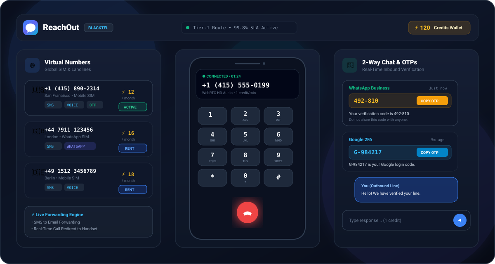
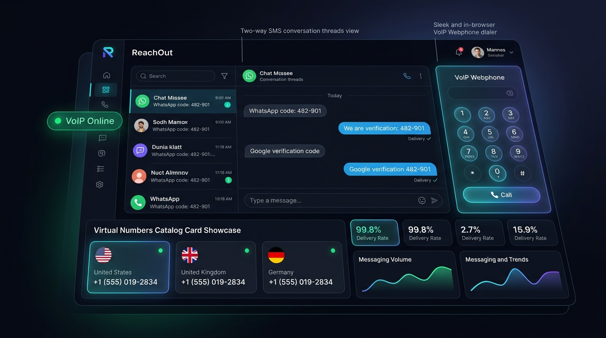

# ReachOut – Cloud Telecommunications & Virtual Messaging Suite

ReachOut is a full-stack cloud messaging and virtual telecommunications platform built with Next.js 15, React 19, Tailwind CSS, and Supabase PostgreSQL with Row Level Security (RLS).

The platform provides international outbound SMS messaging, international virtual phone numbers across 25+ countries, an in-browser Webphone with dual-tone audio dialpad, 2-way conversation threads, and OTP code verification.

---

## Output Preview





---

## Recommended GitHub Repository Information

- **Repository Name:** `reachout-messaging-platform`
- **Description:** `Next.js 15 & Supabase SaaS for international SMS messaging, virtual phone numbers (25+ countries), in-browser VoIP Webphone with dialpad, 2-way chat, and OTP verification.`

---

## Key Features

1. **Virtual Phone Numbers Store**
   - Rent virtual phone numbers from 25+ countries (US, UK, Germany, Canada, France, Australia, Japan, Brazil, India, Netherlands, etc.).
   - Multiple profile types: Mobile numbers, Local landlines, Toll-Free lines, and Disposable short-term numbers.
   - Configurable forwarding: Forward incoming calls and text messages directly to a real mobile number or forward transcripts to email.
   - Customizable automated SMS auto-reply bot per line.

2. **In-Browser Webphone (VoIP)**
   - In-browser calling without external softphones or plugins.
   - Dual-tone multi-frequency (DTMF) dialpad audio tone generator powered by the Web Audio API.
   - Selectable outbound caller ID chosen from rented active numbers.
   - Live call states: Dialing, Ringing, Connected with active duration timer, Mute, and Speakerphone toggles.
   - Loopback test line for audio diagnostics.

3. **2-Way SMS Messenger & OTP Inbox**
   - Split-pane conversation messenger organized by contact threads.
   - Automatic identification and extraction of 4-to-8 digit OTP / 2FA verification codes with a one-click copy button.
   - Live simulation testing for incoming verification text messages.
   - Outbound reply composer with segment and character estimation.

4. **Prepaid Credit Wallet**
   - Transparent credit billing model for number rentals, SMS dispatches, and voice call durations.
   - Configurable credit packages with instant top-up simulation.
   - Complete audit trail of balance credits and deductions.

5. **Security & Abuse Prevention**
   - Supabase Row Level Security (RLS) across all database tables.
   - Anti-harassment rate limiting (max 3 dispatches per 10 minutes to the same recipient).
   - Carrier keyword opt-out processing (automatic suppression list addition upon receiving STOP keywords).
   - Cryptographic signature validation for inbound webhooks.
   - Cross-Site Request Forgery (CSRF) origin verification and input sanitization.

---

## Project Structure

```
ReachOut/
├── app/
│   ├── api/                     # Server-side API endpoints
│   │   ├── abuse/report/        # Abuse report handling
│   │   ├── inbox/               # 2-way chat & OTP simulation
│   │   ├── messages/send/       # SMS dispatch endpoint
│   │   ├── numbers/             # Virtual number search, my numbers, and rental
│   │   ├── security/            # Security challenge & audit logs
│   │   ├── suppression/         # Suppression & opt-out management
│   │   ├── wallet/              # Balance & top-up transactions
│   │   └── webhooks/twilio/     # Inbound carrier webhook receiver
│   ├── dashboard/               # Authenticated SaaS application
│   │   ├── calls/               # Webphone & call records
│   │   ├── history/             # SMS history & telemetry modal
│   │   ├── inbox/               # 2-way SMS chat messenger
│   │   ├── numbers/             # Virtual numbers marketplace
│   │   ├── send/                # Outbound SMS composer
│   │   └── settings/            # Security settings & quotas
│   └── (auth)/                  # Login, registration, password recovery
├── components/                  # UI components (Webphone, Dialpad, Modals)
├── lib/                         # Utilities (rate limiting, security, phone formatting)
├── public/                      # Static assets and screenshot previews
├── services/                    # Business logic (database, numbers, wallet, webphone)
├── supabase/                    # PostgreSQL migrations & schemas
├── .env.example                 # Environment variables template
├── .gitignore                   # Git ignore specifications
└── package.json                 # Project dependencies & scripts
```

---

## Quickstart Guide

### 1. Installation
```bash
git clone https://github.com/YOUR_USERNAME/reachout-messaging-platform.git
cd reachout-messaging-platform
pnpm install
```

### 2. Environment Configuration
Copy `.env.example` to `.env.local`:
```bash
cp .env.example .env.local
```

Fill in your Supabase project credentials in `.env.local`:
```env
NEXT_PUBLIC_SUPABASE_URL=https://your-project.supabase.co
NEXT_PUBLIC_SUPABASE_ANON_KEY=your-anon-key
NEXT_PUBLIC_SITE_URL=http://localhost:3000

# Optional: Twilio credentials (if empty, simulation mode runs automatically)
TWILIO_ACCOUNT_SID=
TWILIO_AUTH_TOKEN=
TWILIO_PHONE_NUMBER=
```

### 3. Database Setup
1. Open your Supabase Dashboard SQL editor.
2. Run the SQL schema script in `supabase/schema.sql`.

### 4. Running Locally
```bash
pnpm dev
```
Open [http://localhost:3000](http://localhost:3000) in your web browser.

---

## Git Push Instructions

Run the following commands in your terminal to initialize and push your project to GitHub:

```bash
git init
git add .
git commit -m "feat: initial commit for ReachOut cloud messaging and virtual telecom platform"
git branch -M main
git remote add origin https://github.com/YOUR_USERNAME/reachout-messaging-platform.git
git push -u origin main
```

---

## License

This project is licensed under the MIT License.
